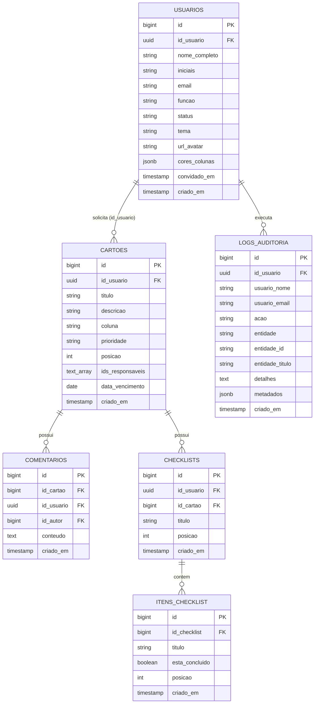

# SGDI - Sistema de Gestão de Demandas de TI

> Plataforma completa e moderna para gerenciamento, rastreamento, análise de indicadores e governança de demandas, tarefas e projetos de equipes de Tecnologia da Informação.

---

## 📌 Visão Geral

O **SGDI** (Sistema de Gestão de Demandas de TI) foi projetado para elevar a produtividade, a rastreabilidade operacional e a governança de times ágeis de tecnologia.

Com interface responsiva e suporte a **Dark Mode**, o sistema oferece:
- **Fluxos Ágeis em Quadro Kanban (`/board`)** com arrastar-e-soltar, paginação interna por coluna, colapso/expansão e customização de cores (com preto absoluto padrão no modo escuro);
- **Visualização em Tabela Corporativa Paginada** (10 em 10 itens) para leitura gerencial densa e auditável;
- **Dashboard Analítico Modular (`/dashboard`)** com KPIs, cumprimento de SLA, carga por responsável, tempo médio por prioridade, lista de demandas críticas, gráficos de tendência (8 semanas) e exportação;
- **Trilha de Logs de Auditoria (`/logs`)** com registro automático de operações, métricas, filtros, modal de detalhes técnicos e exportação em CSV e JSON;
- **Apontamento de Horas com Cronômetro Inteligente**, estimativas por **Nível de Complexidade**, pausas com motivos estruturados, permissão restrita por responsável e registro automático de conclusão;
- **Exportação de Relatórios**: planilha em **CSV** (compatível com Excel) e **Relatório Corporativo para Impressão / PDF**;
- **API REST Integrada (`api_sgdi/`)** em Express + TypeScript com documentação interativa Swagger UI (`/api/docs`) e autenticação por API Key;
- **Arquitetura Híbrida e Resiliente**, unindo PostgreSQL com Row Level Security e Realtime (Supabase) a uma camada local (*offline-first* / fallback em `localStorage`).

---

## 🚀 Tecnologias e Arquitetura

### Front-end (`src/`)
- **React 18** com **TypeScript**
- **Vite** (servidor de desenvolvimento na porta `8080` e build otimizada)
- **React Router DOM v6** (SPA com rotas protegidas e code-splitting via `lazy`/`Suspense`)
- **CSS Nativo Padrão W3C & CSS Variables** (Design System modular com tokens em `src/index.css` e `src/estilos/sistema-design.css`, com suporte a temas Claro, Escuro e Sistema)
- **Radix UI** (Diálogos, Alertas, Menus Suspensos, Popovers, Abas, Selects, Checkboxes, Progresso e Avatares)
- **@dnd-kit** (`@dnd-kit/core`, `@dnd-kit/sortable`, `@dnd-kit/utilities`)
- **@tanstack/react-query v5** e **@tanstack/react-table**
- **Tabler Icons & Lucide React**
- **Date-fns** (formatação internacionalizada em `pt-BR`)
- **Sonner** (notificações toast)

### Back-end, Persistência & Tempo Real
- **Supabase (PostgreSQL)**
  - Tabelas relacionais com IDs sequenciais legíveis (`#1`, `#2`...) para `usuarios`, `cartoes`, `comentarios`, `checklists`, `itens_checklist` e `logs_auditoria`.
  - **Supabase Auth**: autenticação por e-mail/senha e OAuth (Google em `/auth/callback`).
  - **Row Level Security (RLS)** e **Supabase Realtime** (`postgres_changes` em `cartoes`, `comentarios`, `checklists`, `itens_checklist`, `usuarios` e `logs_auditoria`).
- **Camada Local / Resiliente (`localStorage`)**
  - Metadados de produtividade (cronômetro, pausas e complexidade) em `supabase-card-metadata-v1`;
  - Preferências de cores das colunas (`sgdi-cores-colunas-v1`) e módulos do dashboard (`sgdi-dashboard-modulos-v1`);
  - Fallback resiliente para checklists (`supabase-card-checklists-v1`) e logs de auditoria (`sgdi-logs-auditoria-v1`).
- **API REST Externa (`api_sgdi/`)**
  - **Node.js + Express + TypeScript** com **Swagger UI Express** (`/api/docs`), especificação OpenAPI 3.0 (`/api/docs/openapi.json`), autenticação via `X-API-Key` ou `Authorization: Bearer`, e integração com Supabase.
  - Consulte a documentação detalhada em [api_sgdi/README.md](./api_sgdi/README.md).

### Testes Automatizados
- **Front-end (Vitest)**: **49 testes unitários** distribuídos em 4 suítes:
  - `src/App.test.tsx` (23 testes — regras de negócio, ordenação, filtros, paginação e cores)
  - `src/paginas/dashboard/calculos-dashboard.test.ts` (15 testes — KPIs, SLA, carga, tendências e idade de abertas)
  - `src/paginas/logs/logs.test.ts` (6 testes — registro, filtros e exportação de auditoria)
  - `src/paginas/dashboard/exportador-dashboard.test.ts` (5 testes — exportação de dados do dashboard)
- **API REST (`api_sgdi/testes/`)**: 3 suítes com **Vitest + Supertest** (`checklist-api.test.ts`, `demandas.test.ts` e `usuarios.test.ts`).

---

## 🎯 Funcionalidades do Sistema

### 1. Quadro Kanban, Tabela e Detalhes da Demanda (`/board` e `/board/:cardId`)
- **Prioridades**: **Alta**, **Média** e **Baixa**, com ordenação dinâmica por urgência, vencimento, responsável, título, criação ou ordem manual.
- **Complexidade & Estimativa de Horas**: **Baixa** (2h), **Média** (4h), **Alta** (8h) e **Muito Alta** (16h).
- **Solicitantes e Múltiplos Responsáveis**: vínculo relacional com usuários cadastrados (`ids_responsaveis`) e avatares empilhados.
- **Gestão de Prazos**: seletor de data de vencimento com indicadores visuais (*No Prazo*, *Vence Hoje*, *Atrasado*) e restrição de edição ao solicitante ou responsáveis.
- **Checklists e Comentários**: até 5 listas de verificação por cartão com barra de progresso em tempo real e seção de comentários por demanda.
- **Cronômetro e Apontamento de Horas**:
  - Restrito aos responsáveis atribuídos à demanda;
  - Modal de pausa com motivos estruturados ou justificativa personalizada;
  - Finalização automática ao mover o cartão para **Concluído**.
- **Modos de Visualização**:
  - **Quadro Kanban** (3 colunas: `A fazer`, `Em andamento`, `Concluído`) com 16 cores personalizáveis, recolhimento/expansão e paginação interna de 10 em 10 cartões;
  - **Tabela Paginada** com busca global (por `#ID`, título ou descrição), filtros combinados (Status, Prioridade, Solicitante, Responsável) e exportação em **CSV** ou **Impressão / PDF**.

### 2. Dashboard Analítico (`/dashboard`)
- **Módulos Configuráveis na Barra Lateral** (preferências persistidas por usuário):
  - Indicadores (KPIs), Situação das demandas, Cumprimento de SLA, Carga por responsável (com seletor de usuários), Tempo médio de resolução por prioridade e Lista de demandas críticas;
  - Seção de **Tendências (8 semanas)**: Fluxo semanal, Evolução do backlog, SLA semanal e Idade das demandas abertas.
- **Filtros Centralizados** (período, responsável, prioridade, status e busca rápida) e **Exportação de Relatórios** do dashboard.

### 3. Logs de Auditoria (`/logs`)
- Registra automaticamente operações de criação, atualização, exclusão, movimentação, alteração de status, ações do cronômetro, comentários e checklists.
- Tela dedicada com cartões de métricas, filtros por busca/ação/entidade/período, modal com metadados técnicos em JSON e exportação em **CSV** e **JSON**.

### 4. Configurações Pessoais (`/settings`)
- **Aba Perfil**: edição de nome/dados de perfil e alteração de senha.
- **Aba Geral**: alternância de tema (**Claro**, **Escuro** ou **Sistema**) e **Zona de Perigo**.

### 5. API REST (`api_sgdi/`)
- Endpoints públicos: `GET /api`, `GET /api/status`, `GET /api/docs`, `GET /api/docs/openapi.json`.
- Endpoints protegidos por API Key:
  - `GET/POST/PUT/PATCH/DELETE /api/demandas` e `/api/demandas/:id`
  - `GET/POST /api/demandas/:id/comentarios`
  - `GET/POST /api/usuarios` e `GET /api/usuarios/:id`

---

## 📂 Estrutura de Diretórios

```text
Sistema_SGDI/
├── api_sgdi/                        # API REST externa (Express + TypeScript + Swagger)
│   ├── src/                         # App, rotas, controladores, serviços, middlewares e OpenAPI
│   ├── testes/                      # Suítes de teste com Vitest + Supertest
│   └── README.md                    # Documentação completa da API REST
├── public/                          # Ativos públicos estáticos
├── src/
│   ├── componentes/
│   │   ├── base/                    # Botões, Badges e autenticação social
│   │   └── ui/                      # Primitivos Radix UI (diálogo, popover, abas, etc.)
│   ├── estilos/                     # Sistema de Design em CSS nativo
│   ├── integracoes/supabase/        # Cliente Supabase tipado e tipos do schema
│   ├── lib/
│   │   ├── auditoria/               # Serviço de logs de auditoria e exportação CSV/JSON
│   │   ├── autenticacao/            # AuthProvider e hooks de sessão
│   │   ├── provedor-dados/          # Provedor React Query + Realtime + hooks por domínio
│   │   └── utilitarios.ts           # Utilitários de classes CSS
│   ├── paginas/
│   │   ├── autenticacao/            # Login, Cadastro e Retorno OAuth
│   │   ├── configuracoes/           # Abas Perfil e Geral
│   │   ├── dashboard/               # Painel analítico, cálculos, gráficos e exportação
│   │   ├── logs/                    # Tela de Logs de Auditoria
│   │   ├── quadro/                  # Kanban, Tabela, Detalhes, Cronômetro e Checklists
│   │   └── nao-encontrado.tsx       # Página 404
│   ├── tipos/                       # Tipos de domínio (quadro.ts, auditoria.ts)
│   ├── App.tsx                      # Rotas SPA, Suspense e LayoutAutenticado
│   ├── App.test.tsx                 # Suíte principal de testes unitários
│   ├── index.css                    # Design tokens e resets globais
│   └── main.tsx                     # Ponto de entrada React
├── supabase/
│   └── migrations/                  # Scripts SQL de schema, índices e políticas RLS
├── .env.example                     # Modelo de variáveis de ambiente do front-end
├── package.json                     # Dependências e scripts (front-end e atalhos da API)
├── tsconfig.json                    # Configurações do TypeScript
└── vite.config.ts                   # Configurações do Vite
```

---

## 🗄️ Modelo de Dados (Supabase / PostgreSQL)



---

## 🛠️ Instalação e Execução Local

### Pré-requisitos
- **Node.js** (v18+ recomendado; v22+ para `api_sgdi`)
- **npm**
- Uma instância ativa do **Supabase**

### 1. Instalar as dependências
```bash
# Front-end (raiz)
npm install

# API REST (opcional, caso deseje rodar a api_sgdi)
npm --prefix api_sgdi install
```

### 2. Configurar as Variáveis de Ambiente
Copie `.env.example` para `.env` na raiz do projeto e preencha com as credenciais do seu projeto Supabase:
```env
VITE_SUPABASE_URL="https://seu-projeto.supabase.co"
VITE_SUPABASE_PUBLISHABLE_KEY="sua-chave-anonima-publica-ou-sb_publishable"
VITE_SUPABASE_PROJECT_ID="seu-id-de-projeto"
```

### 3. Aplicar as Migrações no Supabase
Execute os scripts da pasta `supabase/migrations/` no **SQL Editor** do Supabase na seguinte ordem:
1. `20260924_tabela_unica_usuarios.sql` *(tabelas principais: `usuarios`, `cartoes`, `comentarios`, `checklists`, `itens_checklist` e RLS)*
2. `20260929_cores_colunas_usuario.sql` *(coluna `cores_colunas` em `usuarios`)*
3. `20261022_tabela_logs_auditoria.sql` *(tabela `logs_auditoria`, índices e RLS)*

*(Habilite também o Realtime no Supabase para as tabelas acima para sincronização instantânea entre clientes.)*

### 4. Iniciar o Ambiente de Desenvolvimento
```bash
# Front-end (http://localhost:8080)
npm run dev

# API REST externa (opcional)
npm run api:dev
```

---

## 🧪 Testes Automatizados

```bash
# Executa todas as 4 suítes do front-end (49 testes)
npx vitest run src/

# Modo contínuo interativo (watch)
npm run test:watch

# Testes da API REST (requer dependências instaladas em api_sgdi/)
npm run api:test
```

---

## 📦 Scripts Disponíveis (`package.json` raiz)

| Comando | Descrição |
| :--- | :--- |
| `npm run dev` | Inicia o servidor de desenvolvimento Vite (HMR) na porta `8080`. |
| `npm run build` | Gera o bundle de produção otimizado em `dist/`. |
| `npm run build:dev` | Compila a aplicação em modo de desenvolvimento. |
| `npm run preview` | Visualiza localmente a build de produção compilada. |
| `npm test` | Executa o Vitest (`vitest run`). Para rodar apenas o front-end: `npx vitest run src/`. |
| `npm run test:watch` | Executa o Vitest em modo interativo contínuo. |
| `npm run lint` | Executa a análise estática com ESLint. |
| `npm run api:dev` | Inicia a `api_sgdi` em modo de desenvolvimento (`tsx watch`). |
| `npm run api:start` | Inicia a `api_sgdi` em modo padrão. |
| `npm run api:build` | Compila o TypeScript da `api_sgdi`. |
| `npm run api:test` | Executa a suíte de testes da `api_sgdi`. |

---

## 📄 Licença

Este projeto é desenvolvido para fins corporativos e acadêmicos de Gestão de Demandas de TI. Distribuído sob a licença **MIT**.
